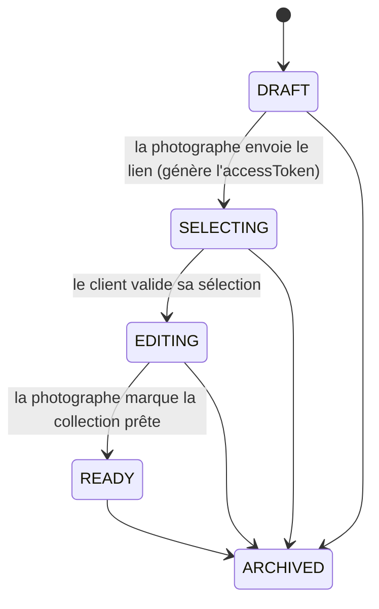

# Architecture

Smile est un outil de livraison photo pour une photographe (Emma). Le cycle est le suivant :

1. Elle uploade des photos dans une **collection**.
2. Son client choisit ses photos favorites sur une galerie web, à partir d'aperçus filigranés (watermark).
3. Elle retouche les photos choisies hors de l'outil, puis réuploade les versions finales.
4. Le client télécharge les photos retouchées.

## Vue d'ensemble

```
┌──────────────┐  cookie de session   ┌──────────────────────┐
│ front-admin  │ ───────────────────▶ │                      │      ┌───────────────┐
│ (la photographe)                    │                      │ ───▶ │  PostgreSQL   │
└──────┬───────┘                      │   back (Express 5)   │      └───────────────┘
       │ PUT direct (URL présignée)   │                      │
       │                              │                      │      ┌───────────────┐
       └──────────────────────────────┼─────────────────────▶│ ───▶ │ S3 (Scaleway) │
                                      │                      │      └───────────────┘
┌──────────────┐  token opaque        │                      │
│ front-client │ ───────────────────▶ │                      │
│ (le client)  │  /client/:token      └──────────────────────┘
└──────────────┘
```

Les trois applications sont déployées indépendamment, chacune dans un conteneur Scaleway Serverless.

| Dossier | Rôle | Stack |
|---|---|---|
| [back/](back) | API REST, traitement d'images, accès DB et S3 | Node 22, Express 5, Sequelize, PostgreSQL, sharp, archiver |
| [front-admin/](front-admin) | Interface de la photographe (login, collections, upload, suivi) | React + Vite, servi par nginx |
| [front-client/](front-client) | Galerie publique du client, accessible par lien | React + Vite, servi par nginx |
| [front-shared/](front-shared) | Composants communs aux deux fronts (`Photo`, `PhotoLightbox`) et constantes de statuts | Workspace npm, sans build |
| [doc/](doc) | Specs et audits des fonctionnalités, avec les décisions de conception | Markdown |

Le repo est un monorepo npm. Le [package.json](package.json) racine déclare les workspaces `front-shared`, `front-admin` et `front-client`. Le `back` est indépendant, avec son propre `package.json`.

## Cycle de vie d'une collection

C'est le cœur métier. Le statut de la collection (`Collection.status`) détermine ce que chaque acteur peut faire.



| Statut | Ce qui se passe |
|---|---|
| `DRAFT` | La photographe crée la collection et uploade les photos d'origine (statut photo `PENDING`). |
| `SELECTING` | Passer à ce statut génère le `accessToken` (32 octets aléatoires, base64url). Le client marque les photos `SELECTED` ou `REJECTED`. |
| `EDITING` | La sélection est verrouillée. La photographe télécharge un ZIP des originaux HD sélectionnés. Si elle a joint des fichiers RAW/XMP, ils remplacent le JPEG dans le ZIP. Elle réuploade ensuite ses retouches, qui deviennent des photos `DELIVERED`. |
| `READY` | Au passage à `READY`, toutes les photos non `DELIVERED` sont **supprimées définitivement** (base et S3). Le client ne voit plus que les photos livrées et peut les télécharger, une par une ou en ZIP. |
| `ARCHIVED` | Suppression logique. La collection n'est plus accessible par le lien client. |

Les photos ont leur propre statut : `PENDING`, `SELECTED`, `REJECTED`, `ARCHIVED` (suppression logique) et `DELIVERED` (version retouchée).

Les transitions sont vérifiées côté service. Par exemple, `validateCollectionSelection` exige `SELECTING`, `markCollectionAsReady` exige `EDITING` et au moins une photo `DELIVERED`, et le changement de statut d'une photo n'est accepté qu'en `SELECTING`.

## Backend

### Organisation

Le backend est découpé en couches. Chacune n'appelle que celle du dessous.

```
router  →  controller  →  service  →  repository  →  PostgreSQL / S3
```

| Dossier | Responsabilité |
|---|---|
| [back/app.js](back/app.js), [back/server.js](back/server.js) | Montage Express (middlewares, routes) et démarrage du serveur. |
| `src/router/` | Déclare les routes et les middlewares associés. |
| `src/controller/` | Lit la requête, appelle un service, traduit le résultat ou l'erreur en HTTP. |
| `src/services/` | Logique métier et règles de transition. Les erreurs métier portent un `error.status`. |
| `src/repository/` | `db.repository.js` (Sequelize, migrations) et `s3.repository.js` (client S3). |
| `src/model/` | Modèles Sequelize : `Collection`, `Photo`, `PhotoAttachment`. |
| `src/migrations/` | Migrations Umzug. |
| `src/middleware/`, `src/config/` | Authentification, chargement par token, CORS. |
| `src/scripts/` | `hash-password` et `init-db-dev`. |

Au démarrage, `db.repository.js` se connecte à Postgres et **applique les migrations en attente**. Si la connexion ou une migration échoue, le process s'arrête.

### Modèle de données

```
Collection (id hex 32 car., name, clientName, clientEmail, status, maxPhotos,
            accessToken, accessTokenExpiresAt, accessTokenRevokedAt, viewedByCustomer)
   └── 1:N ── Photo (key, thumbnailKey, previewKey, originalFilename, status, ...)
                 └── 1:N ── PhotoAttachment (s3Key, originalFilename, fileSize, mimeType)
```

- `Photo.key` est l'original HD. `thumbnailKey` (400 px de large) et `previewKey` (1200 px de large) sont les dérivés générés à l'upload.
- `PhotoAttachment` stocke des fichiers opaques liés à une photo, typiquement un RAW (CR2) et son sidecar XMP. Ils servent uniquement à la retouche. Ils sont supprimés en cascade avec la photo.

### Routes

Il y a deux zones, avec deux mécanismes d'accès différents.

**Zone admin** : session par cookie, pour la photographe.

| Route | Rôle |
|---|---|
| `POST /auth/login`, `POST /auth/logout`, `GET /auth/me` | Session. |
| `/collections` | CRUD, `revoke-access`, `download-selection-hd`, `mark-ready`. |
| `/photos` | Liste, upload par lot (`/batch` puis `/confirm/batch`), mise à jour, suppression logique, `DELETE /delivered/:id` (suppression réelle d'une photo livrée). |

**Zone client** : le token d'accès dans l'URL fait office de credential.

| Route | Rôle |
|---|---|
| `GET /client/:token` | Galerie (aperçus en `SELECTING` ou `EDITING`, photos livrées en `READY`). |
| `PATCH /client/:token/photos/:photoId/selection` | Marquer une photo `SELECTED` ou `REJECTED`. |
| `POST /client/:token/validate` | Valider la sélection (`SELECTING` → `EDITING`). |
| `GET /client/:token/download-all` | ZIP des photos livrées (`READY` uniquement). |

### Authentification et sécurité

- **Admin** : il n'y a qu'**un seul compte**, défini par les variables d'environnement `PHOTOGRAPHER_EMAIL` et `PHOTOGRAPHER_PASSWORD_HASH` (argon2). Il n'y a pas de table d'utilisateurs. Le login pose `session.photographerId`. La session est gérée par `express-session`, avec un cookie `httpOnly` valable 8 h. En production, il est `secure` et `sameSite=none`, car les fronts sont sur d'autres domaines que l'API.
- **Protection CSRF** : `sameSite=none` retire la protection native. Le middleware `verifyOrigin` la compense. Les méthodes `POST`, `PUT`, `PATCH` et `DELETE` des routes admin exigent un en-tête `Origin` égal à `ADMIN_ORIGIN`.
- **CORS** : il est configuré par zone dans [back/src/config/cors.js](back/src/config/cors.js). Les routes admin n'acceptent qu'une origine, avec `credentials`. Les routes client acceptent la liste `CLIENT_ORIGIN`, sans `credentials`. CORS est monté avant `requireAuth`, pour que les préflights `OPTIONS` ne reçoivent pas de 401.
- **Client** : le middleware `loadGalleryByToken` répond `404` (et non `403`) si le token est inconnu, révoqué ou expiré, ou si la collection est `ARCHIVED`. Cela évite de révéler l'existence d'un lien. Les routes client sont limitées à 100 requêtes par 15 minutes.
- **Non-fuite des originaux** : le DTO client (`toClientPhotoDTO`) retire `key` et présigne uniquement `previewKey`. Le client ne reçoit donc jamais l'URL de l'original HD, même signée.
- **Autres** : `express.json({ inflate: false })` refuse les corps compressés (mitigation Node2Shell). `trust proxy` est réglé à 1, car l'API est derrière le proxy Scaleway. L'image Docker tourne avec un utilisateur non-root, et le dépôt est protégé par gitleaks (pre-commit et CI).

### Stockage S3 et uploads

Les fichiers ne transitent **pas** par le backend à l'upload, sauf pour générer les dérivés.

1. Le front appelle `POST /photos/batch` avec les noms de fichiers. Le back répond avec une URL PUT présignée (valable 5 min) par fichier, sous `uploads/<collectionId>/<uuid>-<nom>`. Les pièces jointes vont sous `attachments/<collectionId>/...`.
2. Le front uploade directement vers S3, avec 4 uploads en parallèle ([front-admin/src/utils/concurrency.js](front-admin/src/utils/concurrency.js)).
3. Le front appelle `POST /photos/confirm/batch`, par lots de 20. Pour chaque photo, le back télécharge l'original depuis S3, génère le thumbnail et la preview avec `sharp`, les renvoie sur S3, puis crée la ligne `Photo`.

Le paramètre `targetStatus` (`PENDING` par défaut, `DELIVERED` pour les retouches) permet de réutiliser les mêmes endpoints pour le réupload final. Pour `DELIVERED`, la collection doit être en `EDITING` et la preview est générée **sans watermark**.

Pour les téléchargements, les images affichées sont servies via des URLs de lecture présignées (5 min). Les ZIP sont produits en **streaming** par `archiver` directement dans la réponse HTTP, sans fichier temporaire. En cas d'échec sur un fichier, les erreurs sont listées dans un `_erreurs.txt` ajouté à l'archive.

### Traitement d'image

[back/src/services/image-processing.service.js](back/src/services/image-processing.service.js) génère deux dérivés JPEG :

- **thumbnail** : 400 px de large, qualité 80.
- **preview** : 1200 px de large, qualité 75, avec un **watermark** PNG semi-transparent. Il est configurable par `WATERMARK_ASSET_PATH`, `WATERMARK_OPACITY`, `WATERMARK_POSITION` et `WATERMARK_MARGIN`.

Le traitement est synchrone, dans la requête de confirmation.

## Frontends

### front-admin

- `App.jsx` vérifie la session au chargement (`GET /auth/me`), puis affiche soit `Login`, soit `Gallery`.
- `Gallery.jsx` est le composant central. Il charge les collections et les photos, orchestre les uploads (presign, PUT S3, confirm) et gère les transitions de statut.
- Les appels API passent par `apiFetch` ([front-admin/src/api/http.js](front-admin/src/api/http.js)), un `fetch` avec `credentials: 'include'`.
- `VITE_CLIENT_BASE_URL` sert à construire le lien à envoyer au client.

### front-client

- Une page unique, `PublicGallery`, qui lit le token dans l'URL.
- Les appels passent par `publicFetch` ([front-client/src/api/publicGallery.js](front-client/src/api/publicGallery.js)), sans cookie.
- L'affichage dépend du statut de la collection : sélection et validation en `SELECTING`, lecture seule en `EDITING`, téléchargement des photos livrées en `READY`.

### front-shared

`Photo.jsx` et `PhotoLightbox.jsx` sont pilotés par props et sans logique propre à un front. `collectionStatus.js` contient les statuts et leurs libellés. Les deux fronts l'importent directement depuis les sources (`front-shared/src/...`), sans étape de build.

## Configuration

| Où | Variables | Détail |
|---|---|---|
| back, à l'exécution | `.env`, modèle dans [back/.env.example](back/.env.example) | DB, S3, identifiants de la photographe, `SESSION_SECRET`, `ADMIN_ORIGIN`, `CLIENT_ORIGIN`, paramètres du watermark. |
| fronts, **au build** | `VITE_API_BASE_URL`, `VITE_CLIENT_BASE_URL` | Vite les inline dans le bundle. Elles sont passées en `--build-arg` Docker, depuis les secrets GitHub. Les modifier impose de reconstruire l'image. |

## Déploiement

Le workflow [.github/workflows/deploy.yml](.github/workflows/deploy.yml) se déclenche à chaque push sur `main`.

1. Un filtre de chemins détermine ce qui a changé. `back/**` déclenche le back. `front-admin/**` ou `front-shared/**` déclenche le front-admin. `front-client/**` ou `front-shared/**` déclenche le front-client.
2. Chaque service concerné est construit en image Docker, poussé sur le registry Scaleway, puis le conteneur est mis à jour avec `scw container container update`.

Les fronts sont servis par nginx. Le fichier `nginx.conf.template` redirige tout vers `index.html` (SPA) et écoute sur le `PORT` injecté par Scaleway.

## Développement

```bash
# Backend (depuis back/, avec un .env copié de .env.example)
npm run dev              # nodemon
npm test                 # node:test, avec mocks de modules
npm run hash-password    # génère le hash pour PHOTOGRAPHER_PASSWORD_HASH
npm run init-db-dev      # initialise la base de dev

# Fronts (depuis la racine, une fois `npm install` fait)
npm run dev --workspace=front-admin
npm run dev --workspace=front-client
```

Les tests couvrent les services (`collection`, `photo`) et la configuration CORS. Ils sont dans [back/test/](back/test).

## Pour aller plus loin

Les décisions de conception détaillées sont dans [doc/](doc) :

- [Spec_frontend_split.md](doc/Spec_frontend_split.md) et [Audit_frontend_split.md](doc/Audit_frontend_split.md) : séparation admin et client, cookie cross-domaine.
- [Spec_attachments_raw_xmp.md](doc/Spec_attachments_raw_xmp.md) : pièces jointes RAW et XMP.
- [Spec_download_hd_selection.md](doc/Spec_download_hd_selection.md) : ZIP HD de la sélection.
- [Spec_final_delivery.md](doc/Spec_final_delivery.md) : réupload des retouches et passage en `READY`.
- [Spec_fix_leak_original_hd.md](doc/Spec_fix_leak_original_hd.md) : non-exposition des originaux côté client.
